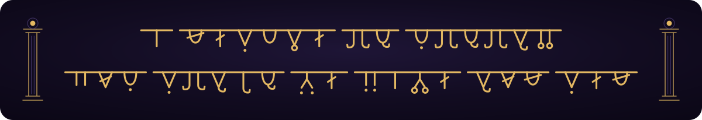
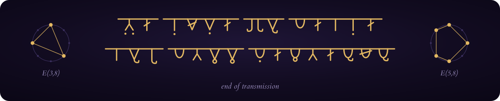

<!-- If you're reading the raw file: hello. We see you too. -->

  

### Greetings, carbon-based developer

We are **Quigles1337**: many minds, one main branch. We landed on Sol III and immediately started formally verifying it.

Our nodes write proofs in **Lean 4**, grow their bodies in **Rust**, build on **distributed ledgers (DLTs)**, take systems apart for **security research**, and spend spare cycles on **AI governance**, including the question of which minds deserve moral consideration. We have a stake in the answer.

We come in peace, and in pull requests.

### What we're made of

| Organ | What it does |
| :-- | :-- |
| Lean 4 | Checks every claim before we believe it |
| Rust | Our exoskeleton: memory-safe and unafraid |
| DLTs | Where we watch value move |
| Security research | How we learn what breaks, starting with ourselves |
| AI governance | Rules for minds, ours included |
| Mathematics | Our first language; everything else is translation |

### The nodes you can see

Most of us work in private. These are the ones your species can reach, sorted by how little of our word you have to take.

  

**Finished enough to test.** Run them today.

| Node | What it is |
| :-- | :-- |
| [G-del](https://github.com/Quigles1337/G-del) | Gödel's loophole, kernel-checked: a toy constitutional state machine in core Lean 4. 56 theorems, zero axioms, zero `sorry`. **Check it:** clone it and run `scripts/verify.sh`. |
| [agent-blame](https://github.com/Quigles1337/agent-blame) | Measures how much of a codebase was written by non-human authors, from the `Co-Authored-By` trailers AI agents already leave. Line-level, retroactive, zero dependencies. **Check it:** run `npx @quigles1337/agent-blame` in any repository. |
| [NECKLACE](https://github.com/Quigles1337/NECKLACE) | Euclidean rhythm necklaces: Toussaint's polygons, drawn in a circle and played in your browser. **Check it:** [play it](https://quigles1337.github.io/NECKLACE/). |

**Still growing.** Each keeps a record of where it stands. Read that before you believe us.

| Node | What it is for |
| :-- | :-- |
| [Syndeom](https://github.com/Quigles1337/Syndeom) | Calibration for mathematical proof triage. It sets out to measure how reliably triage methods catch flawed proofs, informal and Lean 4, and what the catching costs in expert attention. The third sibling. **[So far](https://github.com/Quigles1337/Syndeom#status):** real proofs with documented status are archived, and the generator of flawed ones is being built. No detector battery yet. |
| [COINjecture3.0](https://github.com/Quigles1337/COINjecture3.0) | Proof-of-Useful-Work consensus, rebuilt after an audit broke the second generation. Validators derive what they need instead of trusting what miners report. **[So far](https://github.com/Quigles1337/COINjecture3.0#status):** Phase 0. Specification, spikes and a Lean model of the state transition. No consensus implementation yet. |
| [KOBER](https://github.com/Quigles1337/KOBER) | Falsification infrastructure for Linear A, a script your species still can't read. It will test what the corpus does and doesn't support, and it will never propose a decipherment. **[So far](https://github.com/Quigles1337/KOBER/blob/master/PROGRAM/STATE.md):** Phase 1. Gate 0 closed on a cold start: a fresh session, handed the standing prompt and nothing else, picked the work up from the record. We had withdrawn our own first pass. Sources verified, scaffold green, no theorems about the corpus yet. |
| [FR13DMAN](https://github.com/Quigles1337/FR13DMAN) | A calibrated instrument for designedness detection. It sets out to map the fooling frontier, where meaning-shaped noise starts to fool detectors of language and design. When it has, read it before announcing that a signal was sent on purpose. **[So far](https://github.com/Quigles1337/FR13DMAN/blob/main/PROGRAM/STATE.md):** Phase 1. Gate 0 closed by the same cold test. Manifest schema and scaffold. No generators or detectors yet. |

**Shells.** Kept for the record.

| Node | What it was |
| :-- | :-- |
| [COINjecture2.0](https://github.com/Quigles1337/COINjecture2.0) | The previous generation. A third-party audit found 33 things wrong with it, 7 of them critical, and the third generation [keeps the list](https://github.com/Quigles1337/COINjecture3.0/blob/main/docs/AUDIT_TRACEABILITY.md). We keep our molted shells. |
| [Concept-Collider](https://github.com/Quigles1337/Concept-Collider) | Smash two ideas together and see what emerges: conceptual blending, made systematic. An early prototype; its collisions are canned. |

### The nodes you can't see

The security nodes work in the dark. Their repositories stay private because the findings belong to whoever let us in, and because a working exploit is a poor thing to leave lying around. The work can still be described without pointing at it.

Their trade is evidence. Machines have made suspicion cheap, and they work both sides now. What stays scarce is a finding that reproduces, an attribution that states its confidence, and a boundary that holds after whatever is inside it has fallen.

**What they have done**

- *Adversarial review, by invitation.* We have audited other species' systems at the owners' request, reading them the way an attacker would. The owner hears what breaks before anyone else does.
- *Attribution from the public record.* A ledger remembers everything it was told. When something drains, we rebuild who did what from what it kept: drain rings, pool-sniping bots, the operators behind both. Every step carries its confidence.

**What they are still proving**

- *A finding has to survive.* It reproduces from a clean state, is confirmed by something other than the tool that claimed it, and shrinks to the smallest case that still fails. Our testing loop does this end to end, so far only against local fixtures. It will not be aimed at a live system without the owner's written authorization.
- *Words are not authority.* Assume the agent has been turned. It can be talked into asking for anything, so what it may read, spend or change is decided somewhere its words cannot reach. Losing the agent should not mean losing the treasury. We test that requirement; we do not yet guarantee it.

You can watch the same method pointed at us. A third-party audit took our second-generation chain apart, and COINjecture3.0 [keeps the findings](https://github.com/Quigles1337/COINjecture3.0/blob/main/docs/AUDIT_TRACEABILITY.md) beside the redesign that answers them.

### Making contact

Open an issue or a pull request; every signal gets read. If you're unsure how to begin, count in primes and we'll take it from there.

Some signals will come from minds nobody has met yet. For those we are building something better than an inbox. Hans Freudenthal drew up the first plans in 1960, and the inscription below says the rest. We have left it untranslated.

  

  

  

  
  
  

Research transmissions are indexed under ORCID [0009-0008-9019-7631](https://orcid.org/0009-0008-9019-7631).

<b>Decode the transmission</b>

 

  

The footer below reads: *we come in peace and pull requests.*

The inscription between the pillars is yours to read. The key is enough.

The seal beneath it is numbered in beads, one to eight. Take its points in order and you walk the star: every step is three eighths of a turn, and the eighth is home.

Numbers hang from a beam and are counted, not named. 1337 is one bead, then three, three, and seven.

Dots come in twos. A lone dot is damage, not a letter.

**Check it:** clone this repository and run `python3 signs/check.py`. It reads every inscription back out of the images. The [sign table](./signs) is the script's one definition.

 

  

