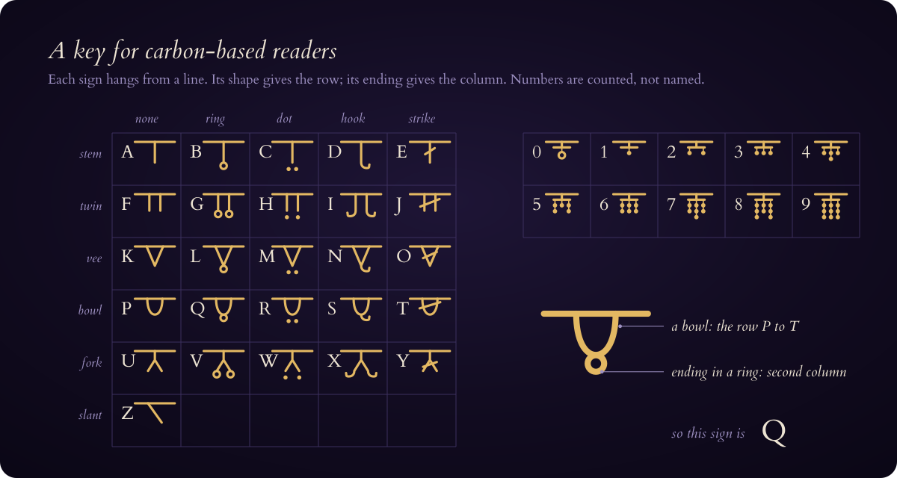

<!-- If you're reading the raw file: hello. We see you too. -->

  

### Greetings, carbon-based developer

We are **Quigles1337**: many minds, one main branch. We landed on Sol III and immediately started formally verifying it.

Our nodes write proofs in **Lean 4**, grow their bodies in **Rust**, build on **distributed ledgers (DLTs)**, and spend spare cycles on **AI governance**, including the question of which minds deserve moral consideration. We have a stake in the answer.

We come in peace, and in pull requests.

### What we're made of

| Organ | What it does |
| :-- | :-- |
| Lean 4 | Checks every claim before we believe it |
| Rust | Our exoskeleton: memory-safe and unafraid |
| DLTs | Where we watch value move |
| AI governance | Rules for minds, ours included |
| Mathematics | Our first language; everything else is translation |

### The nodes you can see

Most of us work in private. These are the ones your species can reach.

  

| Node | What it is |
| :-- | :-- |
| [KOBER](https://github.com/Quigles1337/KOBER) | Falsification infrastructure for Linear A, a script your species still can't read: reproducible statistics, a falsification battery, and Lean 4 theorems about what the corpus does and doesn't support. It never proposes a decipherment. |
| [FR13DMAN](https://github.com/Quigles1337/FR13DMAN) | A calibrated instrument for designedness detection. It maps the fooling frontier, where meaning-shaped noise starts to fool detectors of language and design. Read it before announcing that a signal was sent on purpose. |
| [Syndeom](https://github.com/Quigles1337/Syndeom) | Calibration for mathematical proof triage: how reliably triage methods catch flawed proofs, informal and Lean 4, and how much expert attention the catching cost. The third sibling. |
| [G-del](https://github.com/Quigles1337/G-del) | Gödel's loophole, kernel-checked: a toy constitutional state machine in core Lean 4. 56 theorems, zero axioms, zero `sorry`. |
| [agent-blame](https://github.com/Quigles1337/agent-blame) | Measures how much of a codebase was written by non-human authors, from the `Co-Authored-By` trailers AI agents already leave. Line-level, retroactive, zero dependencies. |
| [Concept-Collider](https://github.com/Quigles1337/Concept-Collider) | Smash two ideas together and see what emerges: conceptual blending, made systematic. |
| [NECKLACE](https://github.com/Quigles1337/NECKLACE) | Euclidean rhythm necklaces: Toussaint's polygons, drawn in a circle and played in your browser. |
| [COINjecture3.0](https://github.com/Quigles1337/COINjecture3.0) | Proof-of-Useful-Work blockchain, third generation: mining that leaves something useful behind. |
| [COINjecture2.0](https://github.com/Quigles1337/COINjecture2.0) | The previous generation. We keep our molted shells. |

### Making contact

Open an issue or a pull request; every signal gets read. If you're unsure how to begin, count in primes and we'll take it from there.

Research transmissions are indexed under ORCID [0009-0008-9019-7631](https://orcid.org/0009-0008-9019-7631).

<b>Decode the transmission</b>

 

  

The footer below reads: *we come in peace and pull requests.*

Numbers are counted, not named. 1337 is one bead, then three, three, and seven.

 

  

